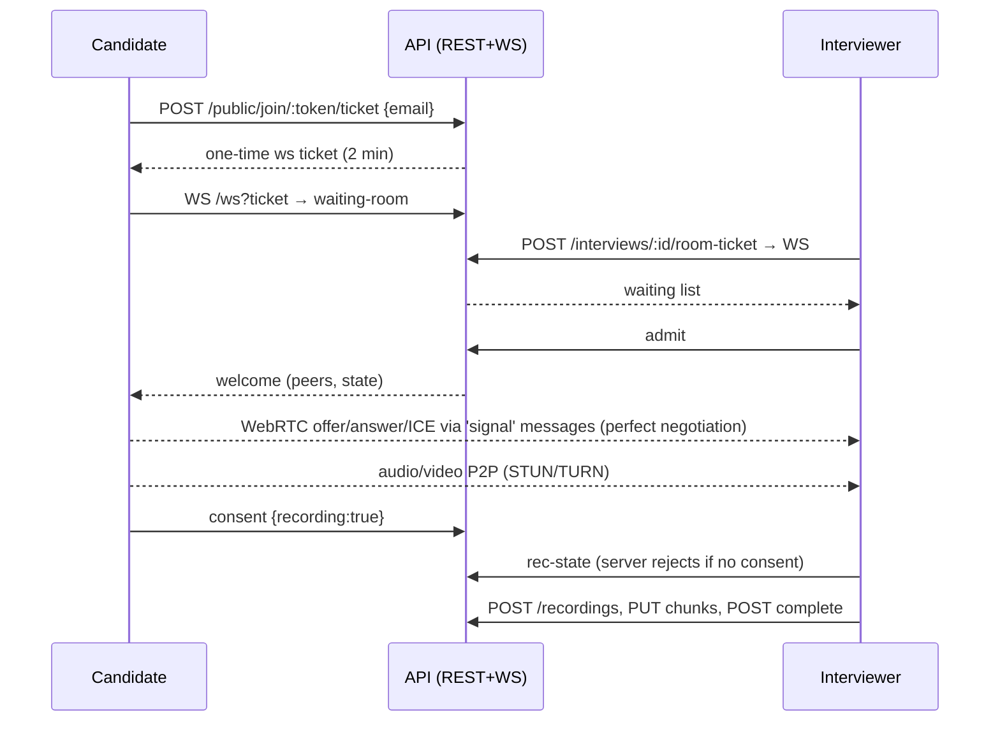

# Architecture

## System context
```mermaid
flowchart LR
  R[Recruiter / Interviewer / Manager] -->|HTTPS + WS| W[Web app (React)]
  C[Candidate browser] -->|HTTPS + WS| W
  P[Candidate phone] -->|QR link| W
  W -->|REST /api, WebSocket /ws| A[API + realtime (Node/Express)]
  A --> DB[(SQLite)]
  A --> FS[(Files: resumes, recordings)]
  A -->|HTTP| J[Judge0 sandbox]
  A -->|HTTP| L[LLM provider (optional)]
  A -->|SMTP| M[Email]
  A -->|REST + webhook| Z[Razorpay]
  R <-->|WebRTC media| C
  R <-->|WebRTC media| P
```

## Modules (modular monolith)
`routes/auth` · `routes/company` (profile, team, notifications, audit, support) · `routes/recruitment` (jobs, candidates, applications, signed files) · `routes/interviews` · `routes/public` (candidate invite, QR camera, recording upload) · `routes/coding` · `routes/evaluation` (feedback, transcripts, AI) · `routes/analytics` · `routes/billing` · `routes/admin` · `realtime.ts` · `code.ts`.

## Tenant isolation
* Identity (`users`) is global; everything else carries `company_id`.
* The tenant id is taken **only from the signed session** (`req.auth.companyId`); no endpoint accepts a company id from the client. Every query on tenant data includes `company_id = ?`; lookups by id use `WHERE id=? AND company_id=?`, so cross-tenant ids return 404.
* Membership is re-checked on every request, so disabling a member takes effect immediately.
* Realtime tickets embed `companyId` + `interviewId`; rooms are keyed by interview id and re-validated against the tenant when loaded.
* Tested: `server/test/api.test.ts` ("tenant isolation").

## Real-time media flow

Media never passes through the API in the mesh design. Peers see each other's tracks directly; the API only relays signalling. The secondary camera peer is **only visible to staff** and neither receives nor sends audio.

## Coding execution flow
Browser → WS `code-run/submit` → API checks entitlement → `runCode()` → **Judge0** (isolated, CPU/wall/memory limits) → result broadcast to the room and logged (`coding_execution_logs`, `coding_submissions`). Hidden test details are redacted for candidates. The API process never executes candidate code unless `CODE_RUNNER=dev-local` outside production.

## AI flow
REST → company AI setting + plan entitlement + monthly cap → optional name-stripping → OpenAI-compatible provider (or rule-based fallback) → saved in `ai_reports` with provider, labelled AI-generated → shown for human editing. No decision endpoint consumes AI output.

## Storage flow
Upload → size/type limit → magic-byte check → malware-scan hook → `storage/files/<companyId>/<uuid>.<ext>` → DB row. Downloads only via **signed, short-lived** (`/api/files/:jwt`) links created per request after a permission check and audit. Retention job purges recordings past `retain_until`.

## Deployment topology
Single container (API + static web) + persistent volume, behind a TLS proxy. Judge0 runs as a separate deployment. TURN server (coturn or hosted) recommended.

## Scaling path
| Need | Change |
|------|--------|
| >1 API instance | PostgreSQL; Redis pub/sub for room fan-out (or sticky sessions); move in-memory tickets to Redis |
| >6 participants / server-side recording | LiveKit SFU + egress; replace `useRoom` with the LiveKit client; remove client recording |
| Object storage | S3/R2 adapter in `services.ts` (save/open/delete + presigned URLs) |
| Concurrent code editing | ✅ Yjs over the existing WS channel (custom Monaco binding); add awareness for remote cursors |
| Background work | Queue (BullMQ/Redis) for emails, parsing, AI, purge |
| NestJS | Routes are already module-shaped; port each router to a Nest module |
